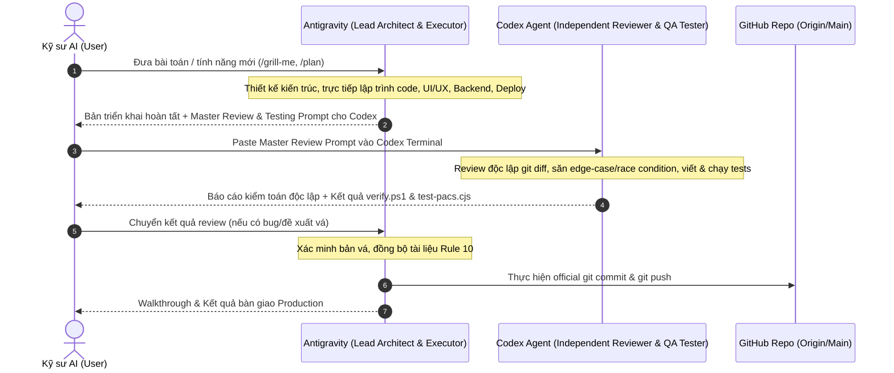

# 🤝 SKILL: DUAL-AGENT COLLABORATION HANDSHAKE
## Quy Trình Phối Hợp Khép Kín: Antigravity (Executor) ⟷ Codex Agent (Independent Reviewer & QA Tester)

---



---

## 1. CÁC BƯỚC THỰC HIỆN CHI TIẾT (STEP-BY-STEP SOP)

### Bước 1: Thiết kế & Thực thi Trực tiếp (Antigravity — Executor)
- **Hành động**: Nhận yêu cầu từ người dùng, quét context qua Rule 0, chốt thiết kế qua `/grill-me` và `/plan`, sau đó trực tiếp lập trình mã nguồn (Frontend, Backend, AI pipeline, Deployment).
- **Đầu ra**:
  - Mã nguồn đã chạy biên dịch sạch (`npm run build` / `pytest`).
  - **Master Review & Testing Prompt** gửi sang Codex Agent để phản biện độc lập.

### Bước 2: Chuyển giao Kiểm toán Độc lập (Hand-off to Reviewer & Tester)
- **Hành động**: Người dùng copy Master Review Prompt dán vào Codex Agent.
- **Quy tắc**: Prompt phải liệt kê rõ:
  1. Danh sách commit / tệp vừa thay đổi cần rà soát.
  2. Các rủi ro trọng điểm cần kiểm tra (race conditions, memory leaks, offline fallback, security, tuân thủ 11 Ràng buộc).
  3. Lệnh kiểm thử bắt buộc (`scripts/verify.ps1`, `node --test scripts/test-pacs.cjs`, `npm run build`).

### Bước 3: Review Code, Săn Bug & Chạy Test (Codex Agent — Reviewer & QA Tester)
- **Hành động**: Codex đọc kỹ `git diff`, kiểm tra logic thực tế không nương tay, viết thêm unit tests cho các hành vi mới, tự vá lỗi nếu phát hiện bug nghiêm trọng.
- **Tiêu chuẩn nghiệm thu**:
  - `powershell -ExecutionPolicy Bypass -File scripts/verify.ps1` đạt 100% PASS.
  - `cd app/frontend; node --test scripts/test-pacs.cjs; npm run build` đạt Exit 0.
  - Xuất bảng kiểm toán rõ ràng (Hạng mục / Trạng thái / Lỗi đã vá / Rủi ro tồn đọng).

### Bước 4: Nghiệm thu Cuối & Đồng bộ GitHub (Antigravity)
- **Hành động**: Rà soát lại báo cáo kiểm toán của Codex, đồng bộ tài liệu (Rule 10), dọn tệp tạm (Rule 8), thực hiện `git commit` và `git push` lên `origin/main`.

---

## 2. KHUNG MASTER PROMPT CHUẨN DÀNH CHO COMMANDCODE (PROMPT TEMPLATE)

Khi Antigravity tạo prompt cho CommandCode, BẮT BUỘC dùng cấu trúc sau:

```markdown
### 🎯 NHIỆM VỤ THỰC THI (TASK DIRECTIVE CHO COMMANDCODE)
- **Mục tiêu**: [Mô tả mục tiêu code logic / fix bug / hyperparam cụ thể]
- **Tệp cần can thiệp**: `[Đường dẫn file chính xác]`

### 🛑 RÀNG BUỘC KỸ THUẬT BẮT BUỘC (CRITICAL CONSTRAINTS)
1. Tuân thủ nghiêm ngặt 9 Ràng Buộc Sống Còn của LungRay (Zero Patient Leakage, 3-Head Independent, Không sửa đổi Data Flow nếu không được yêu cầu).
2. Viết code an toàn, có type hints và docstrings.
3. Tuyệt đối không xóa logic kiểm tra resilient paths trên Kaggle.

### 🧪 YÊU CẦU KIỂM THỬ TRƯỚC KHI BÀN GIAO (MANDATORY VERIFICATION)
Chạy các lệnh sau trong terminal và chỉ thông báo hoàn thành khi 100% thành công:
- `python -m compileall src kaggle tests`
- `powershell -ExecutionPolicy Bypass -File scripts/verify.ps1`
```

