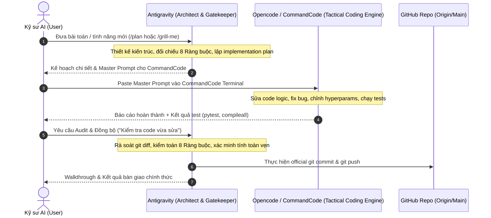

# 🤝 SKILL: DUAL-AGENT COLLABORATION HANDSHAKE
## Quy Trình Phối Hợp Khép Kín: Antigravity (Architect) ⟷ Opencode / CommandCode Go (Tactical Engine)

---



---

## 1. CÁC BƯỚC THỰC HIỆN CHI TIẾT (STEP-BY-STEP SOP)

### Bước 1: Tiếp nhận & Thiết kế Kiến trúc (Antigravity)
- **Hành động**: Nhận yêu cầu từ người dùng, quét toàn bộ context hệ thống qua Rule 0.
- **Đầu ra**: 
  - Tài liệu thiết kế hoặc Plan artifact (`dual_agent_workflow_plan.md`, v.v.).
  - **Master Prompt** được định dạng chuẩn mực dành riêng cho CommandCode / Opencode.

### Bước 2: Chuyển giao Thực thi (Hand-off to Tactical Engine)
- **Hành động**: Người dùng copy Master Prompt do Antigravity sinh ra và dán vào cửa sổ terminal của CommandCode.
- **Quy tắc**: Master Prompt phải ghi rõ:
  1. Mục tiêu kỹ thuật (Task Objective).
  2. Danh sách file cần sửa (Target Files).
  3. Ràng buộc bất di bất dịch (Constraints).
  4. Lệnh kiểm thử bắt buộc (Verification Commands: `scripts/verify.ps1`).

### Bước 3: Thực thi Chiến thuật & Tự Kiểm Thử (CommandCode)
- **Hành động**: CommandCode phân tích prompt, sửa code, chỉnh sửa model/loss/sampler/kaggle scripts.
- **Tiêu chuẩn hoàn thành**: CommandCode chỉ được phép báo xong khi đã tự chạy lệnh kiểm thử và đạt:
  - `python -m compileall src kaggle tests` không có lỗi cú pháp.
  - `powershell -ExecutionPolicy Bypass -File scripts/verify.ps1` vượt qua 100% tests.

### Bước 4: Kiểm Duyệt Chất Lượng & Đồng Bộ Hóa (Antigravity Gatekeeper)
- **Hành động**: Người dùng quay lại Antigravity và yêu cầu kiểm duyệt ("Hãy kiểm tra các thay đổi vừa làm").
- **Antigravity thực hiện**:
  1. `git diff`: Rà soát từng file xem có làm vỡ logic khác không.
  2. Đối chiếu 9 Ràng buộc sống còn (Zero Leakage, Shortcut Audit, 3-Head isolation, v.v.).
  3. Thực hiện `git add`, `git commit` chuẩn Conventional Commits và `git push` lên repository.

---

## 2. KHUNG MASTER PROMPT CHUẨN DÀNH CHO COMMANDCODE (PROMPT TEMPLATE)

Khi Antigravity tạo prompt cho CommandCode, BẮT BUỘC dùng cấu trúc sau:

```markdown
### 🎯 NHIỆM VỤ THỰC THI (TASK DIRECTIVE CHO COMMANDCODE)
- **Mục tiêu**: [Mô tả mục tiêu code logic / fix bug / hyperparam cụ thể]
- **Tệp cần can thiệp**: `[Đường dẫn file chính xác]`

### 🛑 RÀNG BUỘC KỸ THUẬT BẮT BUỘC (CRITICAL CONSTRAINTS)
1. Tuân thủ nghiêm ngặt 9 Ràng Buộc Sống Còn của LungRay (Zero Patient Leakage, 3-Head Independent, Không sửa đổi Data Flow nếu không được yêu cầu).
2. Viết code an toàn, có type hints và docstrings.
3. Tuyệt đối không xóa logic kiểm tra resilient paths trên Kaggle.

### 🧪 YÊU CẦU KIỂM THỬ TRƯỚC KHI BÀN GIAO (MANDATORY VERIFICATION)
Chạy các lệnh sau trong terminal và chỉ thông báo hoàn thành khi 100% thành công:
- `python -m compileall src kaggle tests`
- `powershell -ExecutionPolicy Bypass -File scripts/verify.ps1`
```

