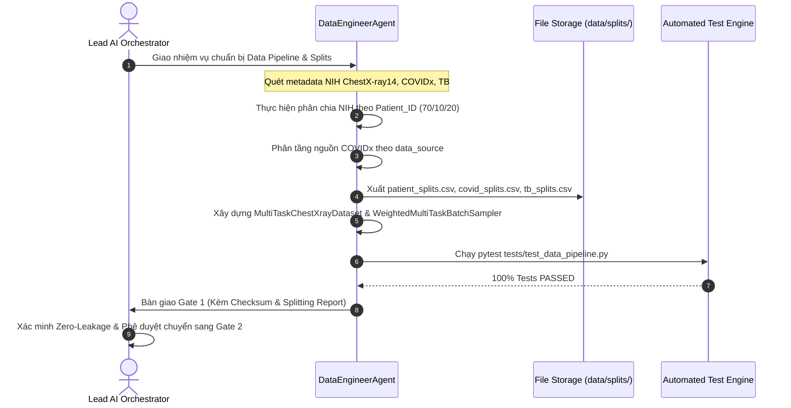

# 🔄 WORKFLOW 01: DATA PIPELINE, ZERO-LEAKAGE SPLIT & SAMPLER SETUP
## Mã Quy Trình: `WORKFLOW-01-DATAOPS-GATE1`
## Phụ trách chính: `DataEngineerAgent` | Phê duyệt: `Lead AI Orchestrator` (Gate 1)
## Tài liệu tham chiếu SSOT: `PRD.md` (Mục 3.1) & `TECH_ARCHITECTURE.md` (Mục 3.1)

---

### 1. MỤC TIÊU QUY TRÌNH
Đảm bảo 100% dữ liệu ảnh X-quang lồng ngực được chuẩn bị theo chuẩn y tế, phân tách tập Train/Val/Test triệt tiêu rò rỉ bệnh nhân (`Patient_ID`), phân tầng nguồn ảnh COVIDx chống học đường tắt, và tích hợp bộ lấy mẫu đa nhiệm `WeightedMultiTaskBatchSampler`.

---

### 2. SƠ ĐỒ CHUYỂN GIAO GIAO TỬ (WORKFLOW SEQUENCE)



---

### 3. CÁC BƯỚC THỰC HIỆN CHI TIẾT (STEP-BY-STEP RUNBOOK)

#### Bước 1.1: Quét và Kiểm Toán Siêu Dữ Liệu (Metadata Audit)
- Đọc file siêu dữ liệu gốc `Data_Entry_2017.csv` của NIH ChestX-ray14.
- Kiểm tra tính nhất quán của cột `Patient ID`, `Finding Labels`, `View Position` (chỉ chọn PA và AP, ưu tiên loại bỏ các ca chụp sai hướng).

#### Bước 1.2: Phân Chia Tập NIH Chống Rò Rỉ (Patient-Level Split)
- Gom cụm danh sách ảnh theo từng `Patient_ID` độc nhất ($N \approx 30,805$ bệnh nhân).
- Chia tách tập bệnh nhân theo tỷ lệ ngẫu nhiên có hạt giống cố định (`seed=42`):
  - Train: 70% số bệnh nhân (~78,484 ảnh)
  - Validation: 10% số bệnh nhân (~11,212 ảnh)
  - Test: 20% số bệnh nhân (~22,424 ảnh)
- **Kiểm tra bắt buộc**:
  ```python
  train_pts = set(train_df['Patient_ID'])
  val_pts = set(val_df['Patient_ID'])
  test_pts = set(test_df['Patient_ID'])
  assert len(train_pts.intersection(val_pts)) == 0, "Rò rỉ bệnh nhân giữa Train và Val!"
  assert len(train_pts.intersection(test_pts)) == 0, "Rò rỉ bệnh nhân giữa Train và Test!"
  assert len(val_pts.intersection(test_pts)) == 0, "Rò rỉ bệnh nhân giữa Val và Test!"
  ```

#### Bước 1.3: Phân Tầng Nguồn COVIDx CXR-4 (Source-Stratified Split)
- Đọc siêu dữ liệu COVIDx, trích xuất cột `data_source` (ví dụ: Cohen, BIMCV, RSNA, RICORD).
- Thực hiện Stratified Group Split theo `data_source` và `patient_id` để đảm bảo mỗi nguồn dữ liệu phân bố đồng đều giữa train và test.

#### Bước 1.4: Cấu Hình Medical Augmentation & MultiTask DataLoader
- Thiết lập pipeline tiền xử lý ảnh an toàn y tế trong `src/data/transforms.py`:
  - `Resize((224, 224))`
  - `RandomRotation(degrees=7)`
  - `RandomAffine(degrees=0, translate=(0.04, 0.04))`
  - `Normalize(mean=[0.485, 0.456, 0.406], std=[0.229, 0.224, 0.225])`
  - *Cấm tuyệt đối*: `RandomVerticalFlip`.
- Cấu hình `WeightedMultiTaskBatchSampler` cố định tỷ lệ phân bổ trong mỗi mini-batch:
  - NIH ChestX-ray14: 60%
  - COVIDx CXR-4: 25%
  - TB Chest Radiography: 15%

---

### 4. CHECKLIST NGHIỆM THU GATE 1 (ACCEPTANCE CHECKLIST)
- [ ] Tập `patient_splits.csv` không tồn tại bất kỳ bệnh nhân nào xuất hiện ở cả Train và Test.
- [ ] Tập `covid_splits.csv` được phân tầng theo `data_source`.
- [ ] Lệnh kiểm thử `pytest tests/test_data_pipeline.py -v` đạt 100% PASS.
- [ ] DataLoader chạy thử nghiệm 1 epoch không gặp lỗi `IndexError` hoặc rỗng batch.
- [ ] Không phát sinh file rác mồ côi trong thư mục gốc.

