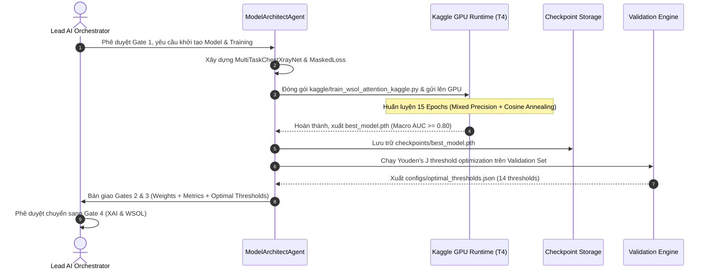

# 🔄 WORKFLOW 02: MULTI-TASK ARCHITECTURE, TRAINING & THRESHOLD TUNING
## Mã Quy Trình: `WORKFLOW-02-MODEL-TRAIN-GATES2-3`
## Phụ trách chính: `ModelArchitectAgent` | Phê duyệt: `Lead AI Orchestrator` (Gates 2 & 3)
## Tài liệu tham chiếu SSOT: `TECH_ARCHITECTURE.md` (Mục 3.2) & `docs/KAGGLE_EXECUTION_GUIDE.md`

---

### 1. MỤC TIÊU QUY TRÌNH
Hiện thực hóa kiến trúc mạng nơ-ron tích chập đa nhiệm (Multi-Task 3-Head) với Shared Encoder, xây dựng động cơ hàm mất mát cô lập gradient (Masked Loss Engine), đóng gói và điều phối quá trình huấn luyện trên hạ tầng Kaggle Tesla T4 GPU, và tối ưu hóa ngưỡng cắt xác suất theo bệnh lý bằng chỉ số Youden's J.

---

### 2. SƠ ĐỒ CHUYỂN GIAO GIAO TỬ (WORKFLOW SEQUENCE)

---

### 3. CÁC BƯỚC THỰC HIỆN CHI TIẾT (STEP-BY-STEP RUNBOOK)

#### Bước 2.1: Khởi Tạo Mạng Đa Nhiệm MultiTaskChestXrayNet
- Nạp Shared Backbone: `torchvision.models.densenet121(weights='DEFAULT')`.
- Tách lớp phân loại mặc định, trích xuất đặc trưng tại `in_features = 1024`.
- Khởi tạo 3 phân nhánh phân loại (Classifier Heads):
  - `head_a = nn.Linear(1024, 14)` (14 bệnh NIH)
  - `head_b = nn.Linear(1024, 1)` (Lao phổi TB)
  - `head_c = nn.Linear(1024, 3)` (Normal / COVID / Pneumonia)

#### Bước 2.2: Thiết Lập Masked Loss Engine
- Định nghĩa lớp `MaskedMultiTaskLoss`:
  $$\mathcal{L}_{\text{total}} = \lambda_A \cdot M_A \cdot \text{BCEWithLogitsLoss}(y_A, \hat{y}_A) + \lambda_B \cdot M_B \cdot \text{BCEWithLogitsLoss}(y_B, \hat{y}_B) + \lambda_C \cdot M_C \cdot \text{CrossEntropyLoss}(y_C, \hat{y}_C)$$
- Đảm bảo khi ảnh thuộc về task nào thì chỉ tính gradient cho head tương ứng.

#### Bước 2.3: Đóng Gói Huấn Luyện Kaggle GPU
- Đóng gói file script `kaggle/train_wsol_attention_kaggle.py` (hoặc mở notebook `notebooks/06_attention_regularized_wsol_finetuning.ipynb`).
- Áp dụng các kỹ thuật tăng tốc và chính quy hóa:
  - Tự động che vùng ngoài phổi (`AnatomicalMaskedDataset`) để loại bỏ watermark và thẻ chữ cái.
  - Tổn thất nhất quán chú ý (`AttentionConsistencyLoss`) hướng năng lượng Grad-CAM vào phế trường.
  - Mixed Precision Training: `torch.cuda.amp.autocast()`.
  - Bộ tối ưu hóa AdamW với Learning Rate phân biệt ($10^{-5}$ cho backbone, $10^{-4}$ cho heads).
  - Cosine Annealing Learning Rate Scheduler.

#### Bước 2.4: Tối Ưu Ngưỡng Youden's J (Optimal Thresholding)
- Nạp mô hình checkpoint `best_model.pth` ở chế độ `model.eval()`.
- Chạy dự đoán trên toàn bộ tập Validation của NIH ChestX-ray14.
- Đối với từng bệnh $c \in \{1, \dots, 14\}$:
  - Quét 100 ngưỡng xác suất $\tau \in [0.05, 0.95]$.
  - Tính Sensitivity và Specificity tại từng ngưỡng.
  - Chọn $\tau_c^* = \arg\max_\tau (\text{Sensitivity} + \text{Specificity} - 1)$.
- Lưu trữ kết quả vào `configs/optimal_thresholds.json`.

---

### 4. CHECKLIST NGHIỆM THU GATES 2 & 3 (ACCEPTANCE CHECKLIST)
- [ ] File checkpoint `checkpoints/best_model.pth` tồn tại, dung lượng chuẩn (~84.6 MB), nạp được không lỗi.
- [ ] Tập cấu hình `configs/optimal_thresholds.json` có đủ 14 ngưỡng bệnh tối ưu.
- [ ] Macro AUROC trên tập Test đạt: Head A $\ge 0.80$, Head B $\ge 0.90$, Head C $\ge 0.70$.
- [ ] Lệnh kiểm thử `pytest tests/test_model_architecture.py` đạt 100% PASS.
