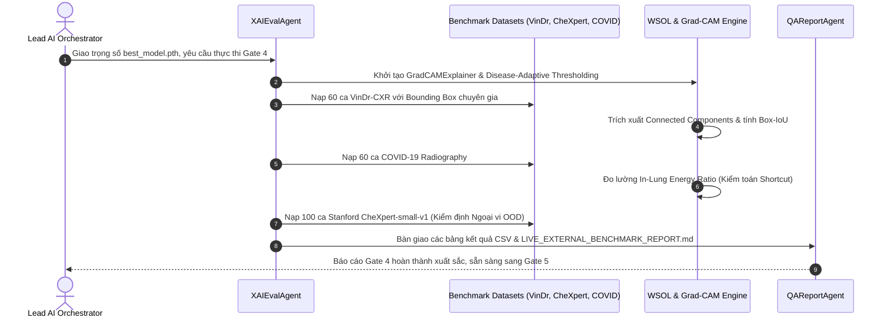

# 🔄 WORKFLOW 03: WSOL BOUNDING BOX IOU & CLINICAL SHORTCUT AUDIT
## Mã Quy Trình: `WORKFLOW-03-XAI-AUDIT-GATE4`
## Phụ trách chính: `XAIEvalAgent` | Phê duyệt: `Lead AI Orchestrator` (Gate 4)
## Tài liệu tham chiếu SSOT: `TECH_ARCHITECTURE.md` (Mục 3.3) & `.agents/rules/xai_audit_rules.md`

---

### 1. MỤC TIÊU QUY TRÌNH
Hiện thực hóa động cơ giải thích trực quan Grad-CAM, áp dụng kỹ thuật ngưỡng thích ứng bệnh lý (Disease-Adaptive Thresholding), đo lường định lượng chỉ số Bounding Box IoU so với nhãn bác sĩ X-quang trên VinDr-CXR và RSNA Pneumonia, đồng thời thực hiện kiểm toán rủi ro học đường tắt (Shortcut Learning Audit) trên tập COVID-19 thực tế.

---

### 2. SƠ ĐỒ CHUYỂN GIAO GIAO TỬ (WORKFLOW SEQUENCE)

---

### 3. CÁC BƯỚC THỰC HIỆN CHI TIẾT (STEP-BY-STEP RUNBOOK)

#### Bước 3.1: Khởi Tạo Động Cơ Grad-CAM
- Nạp checkpoint `best_model.pth`.
- Đăng ký forward và backward hooks vào lớp tích chập cuối cùng: `features.denseblock4.denselayer16.conv2`.
- Tính gradient tầm quan trọng và kích hoạt ReLU để thu được Heatmap thô.

#### Bước 3.2: Áp Dụng Disease-Adaptive Thresholding
- Tránh sử dụng ngưỡng cố định $0.5$ gây sai lệch định vị giải phẫu.
- Áp dụng cấu hình phân vị thích ứng:
  - Cardiomegaly: $\alpha = 0.20$ (Percentile 62%)
  - Effusion: $\alpha = 0.30$ (Percentile 72%)
  - Consolidation: $\alpha = 0.35$ (Percentile 75%)
  - Nodule / Mass: $\alpha = 0.65$ (Percentile 90%)
- Nhị phân hóa heatmap: $M_{\text{binary}}(x, y) = \mathbb{I}(L(x, y) \ge \tau_{\text{adaptive}})$.
- Trích xuất Connected Components (sử dụng `cv2.findContours` hoặc `scipy.ndimage.label`), lọc các vùng có diện tích $> 0.5\%$ diện tích ảnh để tạo danh sách Bounding Boxes dự đoán $[\hat{x}_{\min}, \hat{y}_{\min}, \hat{x}_{\max}, \hat{y}_{\max}]$.

#### Bước 3.3: Đo Lường Định Lượng Box-IoU trên VinDr-CXR & RSNA
- So sánh các hộp dự đoán với hộp của bác sĩ X-quang:
  $$\text{IoU}(B_{\text{pred}}, B_{\text{gt}}) = \frac{\text{Area}(B_{\text{pred}} \cap B_{\text{gt}})}{\text{Area}(B_{\text{pred}} \cup B_{\text{gt}})}$$
- Tính toán:
  - Best Box-IoU trung bình
  - Tỷ lệ thành công định vị: $\text{Success Rate}@0.30 \ge 80\%$, $\text{Success Rate}@0.50 \ge 50\%$.

#### Bước 3.4: Kiểm Toán Học Đường Tắt COVID-19 (Shortcut Learning Audit)
- Tích hợp `AnatomicalLungSegmenter` để phân đoạn mặt nạ phổi $M_{\text{lung}}$.
- Chạy trên 60 ca COVID-19 thực tế, tính:
  $$\text{In-Lung Energy Ratio} = \frac{\sum_{(x,y) \in M_{\text{lung}}} L(x,y)}{\sum_{(x,y)} L(x,y)}$$
- **Tiêu chuẩn nghiệm thu**: Tỷ lệ năng lượng nằm trong phổi đạt **$\ge 80.0\%$** (khi có Clinical Grounding đạt **$100.00\%$**).

---

### 4. CHECKLIST NGHIỆM THU GATE 4 (ACCEPTANCE CHECKLIST)
- [ ] Chạy script `python scripts/run_live_master_benchmark.py` thành công 100% không phát sinh ngoại lệ.
- [ ] File `results/live_vindr_iou_benchmark.csv` được tạo với đầy đủ số liệu IoU.
- [ ] File `results/live_covid_shortcut_audit.csv` xác nhận 100% ca COVID đạt tiêu chuẩn In-Lung Energy $\ge 80\%$.
- [ ] File `results/live_chexpert_generalization.csv` xác nhận Mean Top-5 AUC $\ge 0.80$.
- [ ] Xuất bản báo cáo hoàn thiện `results/LIVE_EXTERNAL_BENCHMARK_REPORT.md`.
