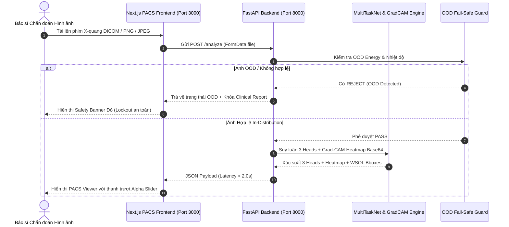

# 🔄 WORKFLOW 04: FULLSTACK API SERVING & MEDICAL PACS VIEWER
## Mã Quy Trình: `WORKFLOW-04-DEPLOY-PACS-GATE5`
## Phụ trách chính: `FullstackDeployAgent` | Phê duyệt: `Lead AI Orchestrator` (Gate 5)
## Tài liệu tham chiếu SSOT: `PRD.md` (Mục 3.5) & `TECH_ARCHITECTURE.md` (Mục 4 & 6)

---

### 1. MỤC TIÊU QUY TRÌNH
Triển khai hệ thống microservice phục vụ suy luận chẩn đoán ảnh X-quang lồng ngực với FastAPI backend độ trễ $\le 2.0$ giây, xây dựng giao diện trạm đọc phim y tế PACS hiện đại (Next.js 14) với thanh trượt Alpha Heatmap tương tác mượt mà, và đóng gói container Docker Compose đạt chuẩn production.

---

### 2. SƠ ĐỒ CHUYỂN GIAO GIAO TỬ (WORKFLOW SEQUENCE)



---

### 3. CÁC BƯỚC THỰC HIỆN CHI TIẾT (STEP-BY-STEP RUNBOOK)

#### Bước 4.1: Kiểm Tra và Khởi Chạy FastAPI Backend
- Kiểm tra mã nguồn trong `app/backend/`:
  - `main.py`: Khởi tạo ứng dụng FastAPI với CORS middleware.
  - `routes.py`: Định tuyến 4 endpoints (`/health`, `/predict`, `/explain`, `/analyze`).
  - `services.py`: Quản lý nạp model `best_model.pth` một lần lúc khởi động.
  - `schemas.py`: Xác thực dữ liệu đầu vào và đầu ra qua Pydantic.
- Chạy kiểm thử tự động backend:
  ```powershell
  pytest tests/test_api_backend.py -v
  ```

#### Bước 4.2: Kiểm Tra Biên Dịch Next.js PACS Frontend
- Kiểm tra kiểu dữ liệu TypeScript (Strict Type Checking):
  ```powershell
  node app/frontend/node_modules/typescript/bin/tsc -p app/frontend/tsconfig.json --noEmit
  ```
- Kiểm tra lỗi cú pháp và chuẩn mã nguồn ESLint:
  ```powershell
  node app/frontend/node_modules/eslint/bin/eslint.js app/frontend/app
  ```
- Đảm bảo các tính năng giao diện hoạt động:
  - Thanh trượt Alpha Slider từ 0% đến 100%.
  - Hiển thị song song ảnh gốc và bản đồ nhiệt Grad-CAM.
  - Khối hiển thị 3-Head đồng thời: 14 bệnh NIH, Lao phổi TB, và COVID-19.
  - Bảng cảnh báo an toàn lâm sàng (Fail-Safe Banner) tự động kích hoạt khi phát hiện OOD.

#### Bước 4.3: Đóng Gói và Khởi Chạy Docker Compose Stack
- Kiểm tra `Dockerfile.backend` và `Dockerfile.frontend`.
- Khởi chạy toàn bộ hệ thống bằng Docker Compose:
  ```powershell
  docker-compose up --build -d
  ```
- Kiểm tra sức khỏe hệ thống:
  - Backend: `curl http://localhost:8000/health` $\to$ Trả về `{"status": "healthy", "model_loaded": true}`.
  - Frontend: Mở trình duyệt tại `http://localhost:3000` $\to$ Giao diện PACS hiển thị đầy đủ, không có lỗi console.

---

### 4. CHECKLIST NGHIỆM THU GATE 5 (ACCEPTANCE CHECKLIST)
- [ ] Backend API trả về kết quả suy luận trong vòng $\le 2.0$ giây.
- [ ] TypeScript compile đạt 0 lỗi (`tsc --noEmit`).
- [ ] ESLint đạt 0 lỗi và 0 warnings.
- [ ] Lệnh kiểm thử `pytest tests/test_api_backend.py` đạt 100% PASS.
- [ ] Kiểm thử Fail-Safe Lockout hoạt động chuẩn xác trên các mẫu ảnh dị tật/nhiễu.
