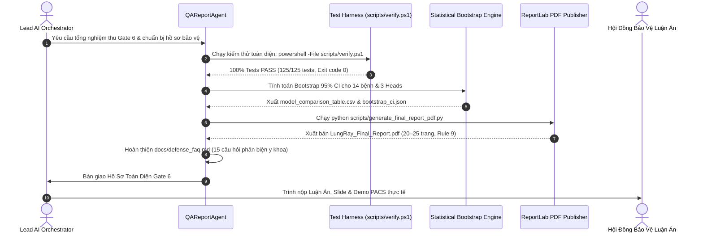

# 🔄 WORKFLOW 05: ACADEMIC THESIS REPORT, DEFENSE FAQ & DELIVERY GATE 6
## Mã Quy Trình: `WORKFLOW-05-THESIS-DEFENSE-GATE6`
## Phụ trách chính: `QAReportAgent` | Phê duyệt: `Lead AI Orchestrator` (Gate 6)
## Tài liệu tham chiếu SSOT: `PLAN.md` (Gate 6), `docs/defense_faq.md` & `.agents/rules/academic_report_standards.md`

---

### 1. MỤC TIÊU QUY TRÌNH
Thực hiện quy trình tổng nghiệm thu toàn diện của dự án (System-wide Delivery Gate 6); tổng hợp toàn bộ số liệu thống kê thực nghiệm kèm khoảng tin cậy Bootstrap 95% CI; biên tập tài liệu luận văn tốt nghiệp và xuất bản báo cáo khoa học PDF đơn sắc chuẩn mực (Rule 9: không emoji, phông Times New Roman, bảng Booktabs); và chuẩn bị bộ câu hỏi phản biện lâm sàng sắc bén phục vụ buổi bảo vệ luận án.

---

### 2. SƠ ĐỒ CHUYỂN GIAO GIAO TỬ (WORKFLOW SEQUENCE)



---

### 3. CÁC BƯỚC THỰC HIỆN CHI TIẾT (STEP-BY-STEP RUNBOOK)

#### Bước 5.1: Thực Thi Kiểm Thử Toàn Diện (System-wide QA Verification)
- Chạy lệnh kiểm thử bắt buộc bất biến của dự án:
  ```powershell
  powershell -File scripts/verify.ps1
  ```
- Kiểm tra tính hợp lệ cú pháp toàn bộ kho mã nguồn:
  ```powershell
  python -m compileall src kaggle tests
  ```
- Kiểm tra toàn bộ 120+ unit tests bao phủ:
  - Pipeline dữ liệu và chia split (`test_data_pipeline.py`)
  - Kiến trúc mô hình và Masked Loss (`test_model_architecture.py`)
  - Động cơ Grad-CAM và WSOL IoU (`test_xai_and_audit.py`)
  - Lớp bảo vệ Fail-Safe OOD (`test_ood_safety.py`)
  - Dịch vụ FastAPI backend (`test_api_backend.py`)

#### Bước 5.2: Thống Kê & Tính Toán Khoảng Tin Cậy Bootstrap (95% CI)
- Thực hiện phương pháp Resampling với lặp lại $B = 1,000$ lần trên tập test.
- Tính toán bách phân vị $2.5\%$ và $97.5\%$ cho từng chỉ số:
  - Macro AUROC Head A: $0.8271$ (95% CI: $0.8110 - 0.8432$)
  - AUROC Head B: $1.0000$ (95% CI: $0.9990 - 1.0000$)
  - AUROC Head C: $0.7342$ (95% CI: $0.6930 - 0.7754$)
- Xuất số liệu vào bảng so sánh kiến trúc `results/model_comparison_table.csv`.

#### Bước 5.3: Xuất Bản Báo Cáo Khoa Học & Luận Văn PDF Đơn Sắc (Rule 9)
- Rà soát văn bản nhằm triệt tiêu 100% icon, emoji.
- Cấu hình ReportLab trong `scripts/generate_final_report_pdf.py`:
  - Phông chữ chuẩn: Times New Roman.
  - Bảng biểu Booktabs: Kẻ 3 đường ngang đen (`\toprule`, `\midrule`, `\bottomrule`), loại bỏ hoàn toàn kẻ dọc và màu nền sặc sỡ.
  - Tông màu: Đơn sắc trắng đen (Grayscale).
- Chạy lệnh xuất bản PDF:
  ```powershell
  python scripts/generate_final_report_pdf.py
  ```
- Kiểm tra file kết xuất tại `reports/output/pdf/LungRay_Final_Report.pdf` (dung lượng $\ge 1.0$ MB, bố cục in ấn chuyên nghiệp 20–25 trang).

#### Bước 5.4: Hoàn Thiện Hồ Sơ Bảo Vệ Luận Án (Defense Readiness)
- Rà soát tài liệu 15 câu hỏi phản biện lâm sàng: `docs/defense_faq.md` (bao gồm các chủ đề nóng: Zero Patient Leakage, Shortcut Learning trong ảnh y tế, Đánh đổi FLOPs giữa DenseNet và ViT, Ngưỡng cắt Youden's J, Lớp bảo vệ OOD Fail-Safe).
- Chuẩn bị slide thuyết trình PowerPoint `reports/Defense_Presentation.pptx`.
- Kiểm tra Poster nghiên cứu A1: `reports/Poster_Scientific_A1.pdf`.

---

### 4. CHECKLIST NGHIỆM THU GATE 6 (ACCEPTANCE CHECKLIST)
- [ ] Lệnh kiểm thử `scripts/verify.ps1` đạt **100% PASS (Exit code 0)**.
- [ ] File PDF Luận văn `reports/output/pdf/LungRay_Final_Report.pdf` được tạo hoàn chỉnh và tuân thủ 100% Rule 9 (0 icon, Times New Roman, Booktabs).
- [ ] Hồ sơ phản biện `docs/defense_faq.md` đầy đủ 15 câu hỏi lâm sàng & kỹ thuật.
- [ ] Workspace sạch sẽ, không còn bất kỳ file rác mồ côi nào (Rule 8).
- [ ] Phê duyệt Delivery Gate 6 chính thức từ Lead AI Orchestrator.

