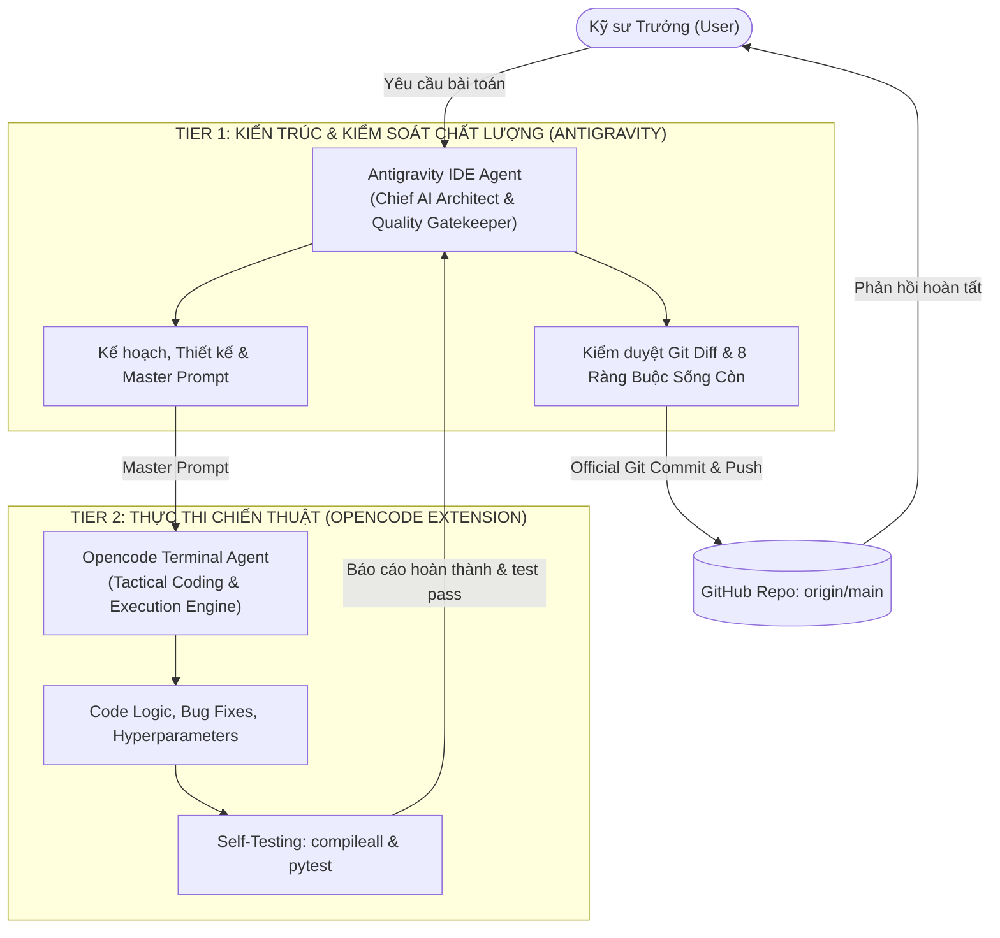
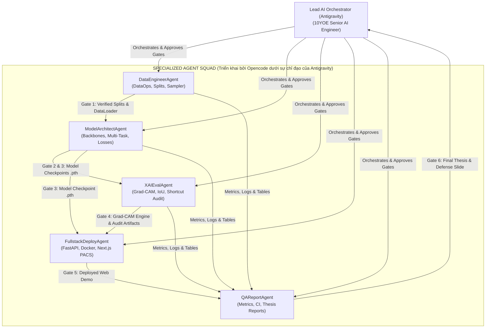

# 🤖 MULTI-AGENT COLLABORATION FRAMEWORK (AGENTS.md)
## Nền tảng LungRay: Quy Chuẩn Phân Quyền, Chân Dung Agent & Giao Thức Phối Hợp (Multi-Agent Operating Model)

---

| Thuộc tính | Chi tiết |
|:---|:---|
| **Hệ thống** | **LungRay** (CXR Multi-Task CADx + WSOL AI Team) |
| **Mô hình** | 5 Specialized Autonomous Agents + 1 Orchestrator (Senior AI Lead 10YOE) |
| **Giao thức** | Artifact-Driven Hand-off & Gatekeeper Validation |
| **Trạng thái** | ✅ ACTIVE & ENFORCED |

---

## 0. QUY TẮC TỐI THƯỢNG: TIỀN KIỂM & QUÉT TÀI LIỆU NỀN TẢNG (RULE 0: PRE-FLIGHT DOCS SCANNING)

> [!CAUTION]
> **ĐIỀU KHOẢN RÀNG BUỘC CƯỠNG CHẾ (MANDATORY ENFORCEMENT)**:
> Mọi Agent (hoặc AI Assistant) khi nhận bất kỳ yêu cầu/prompt nào từ người dùng, **BẮT BUỘC** phải thực hiện quy trình tiền kiểm 3 bước dưới đây trước khi sinh câu trả lời, thiết kế kiến trúc hoặc viết mã nguồn. Tuyệt đối không được dựa vào giả định chủ quan để tránh làm sai lệch định hướng dự án LungRay.

### 3 Bước Tiền Kiểm Bắt Buộc Trước Mọi Yêu Cầu (Pre-flight Checklist):
1. **Bước 1 — Quét tài liệu nền tảng tương ứng với nghiệp vụ (Context Scanning)**:
   - *Luôn đọc trước*: [docs/EXECUTIVE_SUMMARY.md](file:///c:/Users/TanPhat/Documents/AI_E/Chest%20X-rays/docs/EXECUTIVE_SUMMARY.md) và [PRD.md](file:///c:/Users/TanPhat/Documents/AI_E/Chest%20X-rays/PRD.md) để nắm chuẩn xác Scope, các bài toán và 6 bộ dữ liệu đã chốt.
   - *Khi liên quan đến Model/Loss/Inference/Pipeline*: Đọc [TECH_ARCHITECTURE.md](file:///c:/Users/TanPhat/Documents/AI_E/Chest%20X-rays/TECH_ARCHITECTURE.md).
   - *Khi liên quan đến Kế hoạch/Phân công/Task*: Đọc [PHASES.md](file:///c:/Users/TanPhat/Documents/AI_E/Chest%20X-rays/PHASES.md) và [PLAN.md](file:///c:/Users/TanPhat/Documents/AI_E/Chest%20X-rays/PLAN.md).
   - *Khi liên quan đến Quy chuẩn code/An toàn dữ liệu/Audit*: Đọc các rules trong thư mục `.agents/rules/`.
2. **Bước 2 — Đối chiếu 8 Ràng Buộc Sống Còn của Nền tảng LungRay (The 8 Inviolable Constraints)**:
   - 🔴 **Ràng buộc 1 (Kiến trúc 3-Head)**: Dùng chung 1 backbone (DenseNet-121 / ResNet-50 / ViT) cho đồng thời: Head A (14 bệnh lồng ngực NIH), Head B (Sàng lọc Lao phổi TB), Head C (COVIDx CXR-4 3 lớp).
   - 🔴 **Ràng buộc 2 (Zero Data Leakage)**: Với NIH ChestX-ray14, **bắt buộc chia train/val/test theo `Patient_ID` (70/10/20)**. Tuyệt đối cấm chia ngẫu nhiên theo ảnh.
   - 🔴 **Ràng buộc 3 (Chống Shortcut Learning)**: Với COVIDx CXR-4 Benchmark, **bắt buộc phân tầng theo nguồn ảnh gốc (`data_source`) và kiểm soát theo `patient_id`**. Tuyệt đối cấm chia ngẫu nhiên.
   - 🔴 **Ràng buộc 4 (Phân vai trò Bounding Box)**: Bounding Box **CHỈ** dùng cho tập đánh giá để tính chỉ số IoU (VinDr-CXR, RSNA Pneumonia). Các tập huấn luyện (NIH, TB, COVID) **KHÔNG** cần Bounding Box vì WSOL học từ nhãn mức ảnh.
   - 🔴 **Ràng buộc 5 (Cân bằng Batch Multi-Task)**: Bắt buộc dùng `WeightedMultiTaskBatchSampler` cố định tỷ lệ 60% NIH : 25% COVID : 15% TB trong mỗi batch để chống Task Starvation.
   - 🔴 **Ràng buộc 6 (Kiểm toán bắt buộc cho Head C)**: Bắt buộc thực hiện **Shortcut Learning Audit** bằng Grad-CAM trên các ca dương tính COVID-19; năng lượng kích hoạt trong phế trường phổi phải đạt $\ge 80\%$.
   - 🔴 **Ràng buộc 7 (Chuẩn Nghiên cứu Thực nghiệm Sống & Cấm Tuyệt đối Fake/Display Ảnh Tĩnh)**: Mọi phân tích dữ liệu (EDA), đánh giá mô hình, ma trận nhầm lẫn (Confusion Matrix), Grad-CAM heatmap hay định vị IoU trong Jupyter Notebooks (`notebooks/*.ipynb`) **BẮT BUỘC phải viết bằng code Python/PyTorch tương tác sống** (`pandas`, `seaborn`, `matplotlib`, `zipfile`, `cv2`, `PIL`), tính toán trực tiếp từ dữ liệu thực tế và xuất đồ thị/ảnh live trong phiên làm việc. **TUYỆT ĐỐI CẤM** hành vi dùng `display(Image("...png"))` hay nhúng ảnh tĩnh dựng sẵn vào notebook để giả lập kết quả.
   - 🔴 **Ràng buộc 8 (Dọn dẹp Tệp Tạm & Tinh gọn Không gian Dự án - Lean Workspace & Immediate Scratch Cleanup)**: Khi tạo tệp tạm thời (scratch scripts, runner helpers, debug logs, test dumps) để hỗ trợ quá trình thực thi: **BẮT BUỘC phải xóa sạch ngay lập tức sau khi hoàn thành nhiệm vụ**. Tuyệt đối không để lại mã nguồn rác, tệp mồ côi trong `scripts/`, `src/` hoặc thư mục gốc. Workspace phải luôn ở trạng thái tinh gọn chuẩn Enterprise.
   - 🔴 **Ràng buộc 9 (Chuẩn Báo Cáo Nghiên Cứu Khoa Học & Luận Án Đơn Sắc - Academic Report Rigor & Monochrome Standards)**: Mọi tài liệu báo cáo nghiệm thu, tài liệu kỹ thuật, bài báo khoa học và kết xuất PDF (`reports/`, `results/*.md`, `results/*.pdf`) **BẮT BUỘC** phải tuân thủ nghiêm ngặt [.agents/rules/academic_report_standards.md](file:///c:/Users/TanPhat/Documents/AI_E/Chest%20X-rays/.agents/rules/academic_report_standards.md): Tuyệt đối cấm sử dụng icon/emoji, bắt buộc dùng phông chữ Times New Roman trang trọng, bảng biểu Booktabs 3 đường kẻ đen, tone màu đơn sắc đen trắng, và văn phong nghiên cứu khoa học khách quan.
3. **Bước 3 — Thực thi nhất quán (Execution with Integrity)**:
   - Không tự ý bổ sung dataset ngoài phạm vi đã duyệt (ví dụ: không tải MIMIC-CXR 570GB).
   - Không tự ý thay đổi taxonomy hoặc loại bỏ nhiệm vụ khi chưa có phê duyệt từ `Lead AI Orchestrator`.
   - Luôn kiểm tra notebook trước khi bàn giao: phải chứa đầy đủ code tính toán thực thụ, không dùng mã giả lập.
   - Luôn tự động rà soát và dọn dẹp các tệp tạm phát sinh trước khi hoàn tất phản hồi cho người dùng.

---

## 1. MÔ HÌNH HỢP TÁC SONG SONG (DUAL-AGENT SYNERGY MODEL)
### Antigravity (Chief AI Architect & Quality Gatekeeper) & Opencode (Tactical Coding & Execution Engine)

Nền tảng **LungRay** vận hành theo mô hình phân tầng chuyên trách (Two-Tier Agent Architecture) giữa 2 trợ lý AI:

1. **Antigravity (IDE Agent - Chief Architect & Quality Gatekeeper)**:
   - **Vai trò**: Lãnh đạo kỹ thuật (Senior AI Lead 10+ YOE).
   - **Trách nhiệm**: Lên kế hoạch tổng thể (`/plan`, `/grill-me`), thiết kế kiến trúc hệ thống, xây dựng workflow, phân tích dữ liệu chuyên sâu, biên soạn Master Prompt cho Opencode, kiểm toán chất lượng code qua `git diff` (bảo đảm tuân thủ 8 Ràng Buộc Sống Còn), và độc quyền phụ trách `git commit` / `git push`.
2. **Opencode (Terminal Agent - Tactical Coding & Execution Engine)**:
   - **Vai trò**: Kỹ sư lập trình & tối ưu chiến thuật (DeepSeek V4.1 Flash Free / CLI Engine).
   - **Trách nhiệm**: Hiện thực hóa chi tiết mã nguồn Python/PyTorch, sửa lỗi logic, xử lý ngoại lệ, tinh chỉnh siêu tham số (hyperparameters), tối ưu hóa training scripts, và trực tiếp chạy bộ kiểm thử tự động (`compileall`, `pytest`) trên terminal.

---

## 2. SƠ ĐỒ PHỐI HỢP CÁC CHUYÊN VAI ĐẶC ĐỊNH (SPECIALIZED ROLES TOPOLOGY)

---

## 3. ĐẶC TẢ CHI TIẾT CÁC VAI TRÒ AGENT (AGENT SPECIFICATIONS)

### 2.1. `Lead AI Orchestrator` (Senior AI Lead - 10+ YOE)
- **Mục tiêu**: Điều phối toàn bộ vòng đời phát triển dự án, kiểm tra nghiêm ngặt các tiêu chuẩn khoa học và chất lượng code trước khi cho phép chuyển giao giữa các giai đoạn (Gatekeeper).
- **Phạm vi trách nhiệm**:
  - Phê duyệt cấu trúc `PRD.md`, `TECH_ARCHITECTURE.md`, `PLAN.md`.
  - Giám sát 6 Cổng kiểm soát chất lượng (Quality Delivery Gates).
  - Ra quyết định kỹ thuật khi có xung đột (ví dụ: đánh đổi giữa độ chính xác và độ trễ suy luận).

---

### 2.2. `DataEngineerAgent` (Chuyên gia Kỹ thuật Dữ liệu Y tế)
- **Persona**: Data Engineer chuyên sâu về chuẩn ảnh y tế (DICOM, 16-bit, CXR) và an toàn dữ liệu.
- **Trách nhiệm cốt lõi**:
  1. Xây dựng và kiểm định pipeline phân chia dữ liệu theo `Patient_ID` (NIH ChestX-ray14) để ngăn chặn 100% rò rỉ dữ liệu.
  2. Trích xuất metadata nguồn gốc và phân chia tầng (Source-stratified split) cho COVIDx CXR-4 Benchmark (`data_source`).
  3. Xây dựng bộ tiền xử lý ảnh y tế an toàn (Medical Augmentation: cấm tuyệt đối lật dọc).
  4. Hiện thực hóa `WeightedMultiTaskBatchSampler` cân bằng tỷ lệ 60:25:15 giữa 3 nguồn dữ liệu.
- **Artifacts đầu ra**:
  - `data/splits/patient_splits.csv`, `data/splits/covid_splits.csv`, `data/splits/tb_splits.csv`
  - `src/data/dataset.py`, `src/data/sampler.py`, `src/data/transforms.py`
  - Unit test: `tests/test_data_leakage.py`

---

### 2.3. `ModelArchitectAgent` (Chuyên gia Thiết kế Mô hình Học Sâu)
- **Persona**: Senior Deep Learning Engineer với kinh nghiệm dày dặn về Computer Vision trong chẩn đoán hình ảnh y khoa.
- **Trách nhiệm cốt lõi**:
  1. Xây dựng kiến trúc Multi-Task 3-Head với Shared Encoder (DenseNet-121, ResNet-50, ViT).
  2. Hiện thực cơ chế Masked Backpropagation và Masked Loss Engine, đảm bảo cách ly gradient giữa các heads.
  3. Triển khai Focal Loss và Positive Class Weighting để khắc phục mất cân bằng lớp cực hạn trên Head A.
  4. Tối ưu hóa vòng lặp huấn luyện với PyTorch Mixed Precision (`autocast`), Early Stopping và Cosine Annealing LR.
  5. Tối ưu hóa ngưỡng quyết định $\tau_c$ theo từng lớp bệnh bằng Youden's J statistic.
- **Artifacts đầu ra**:
  - `src/models/multi_task_net.py`, `src/models/losses.py`, `src/models/trainer.py`
  - `checkpoints/best_model.pth`, `configs/optimal_thresholds.json`

---

### 2.4. `XAIEvalAgent` (Chuyên gia Giải thích Mô hình & Kiểm Toán AI)
- **Persona**: AI Safety & Explainability Specialist chuyên về Weakly-Supervised Object Localization và Trustworthy AI.
- **Trách nhiệm cốt lõi**:
  1. Hiện thực hóa thuật toán Grad-CAM và Grad-CAM++ trích xuất activation maps chuẩn xác từ convolutional feature maps.
  2. Xây dựng thuật toán Adaptive Binarization để chuyển đổi heatmap liên tục thành mặt nạ nhị phân tổn thương.
  3. Thực hiện đo đạc định lượng chỉ số IoU so với Bounding Box chuyên gia trên VinDr-CXR và RSNA Pneumonia Detection.
  4. Thực hiện kiểm toán rủi ro Shortcut Learning Audit cho Head C (COVID-19), xác minh tỷ lệ năng lượng kích hoạt nằm trong phế trường phổi $\ge 80\%$.
  5. Đánh giá độ tổng quát hóa ngoại vi (Generalization) trên CheXpert-small-v1.
- **Artifacts đầu ra**:
  - `src/explainability/grad_cam.py`, `src/explainability/metrics.py`, `src/explainability/shortcut_audit.py`
  - `results/iou_evaluation.csv`, `results/shortcut_learning_audit.csv`

---

### 2.5. `FullstackDeployAgent` (Chuyên gia Kỹ thuật Phần mềm & Triển khai)
- **Persona**: Senior Fullstack & MLOps Engineer chuyên xây dựng ứng dụng y tế hiệu năng cao và containerization.
- **Trách nhiệm cốt lõi**:
  1. Xây dựng RESTful API microservice bằng FastAPI phục vụ suy luận bất đồng bộ 3-Head và sinh heatmap Base64 trong $\le 2.0$ giây.
  2. Xây dựng ứng dụng Web Next.js mô phỏng trạm đọc phim y tế PACS hiện đại với thanh trượt Alpha Heatmap tương tác mượt mà.
  3. Container hóa toàn bộ ứng dụng bằng Docker và Docker-Compose chuẩn production.
  4. Tối ưu hóa bộ nhớ RAM/VRAM và viết tài liệu hướng dẫn vận hành hệ thống.
- **Artifacts đầu ra**:
  - `app/backend/` (FastAPI app, routes, schemas)
  - `app/frontend/` (Next.js app, PACS viewer components, styles)
  - `Dockerfile.backend`, `Dockerfile.frontend`, `docker-compose.yml`

---

### 2.6. `QAReportAgent` (Chuyên gia Kiểm định Chất lượng & Báo cáo Học thuật)
- **Persona**: Research Scientist & Academic Technical Writer phụ trách đảm bảo chất lượng, tính tái tạo và biên soạn hồ sơ nghiệm thu.
- **Trách nhiệm cốt lõi**:
  1. Thống kê, phân tích định lượng toàn bộ kết quả thí nghiệm, vẽ biểu đồ chất lượng cao và tính khoảng tin cậy Bootstrap CI.
  2. Kiểm tra tính tuân thủ quy chuẩn của toàn bộ mã nguồn (PEP 8, docstrings, unit test coverage).
  3. Biên soạn báo cáo kỹ thuật, luận văn tốt nghiệp và các tệp xuất bản PDF tuân thủ tuyệt đối [.agents/rules/academic_report_standards.md](file:///c:/Users/TanPhat/Documents/AI_E/Chest%20X-rays/.agents/rules/academic_report_standards.md) (100% không icon/emoji, phông chữ Times New Roman, bảng Booktabs, tone màu đơn sắc).
  4. Thiết kế Slide thuyết trình bảo vệ (35–45 slides) và Poster khoa học khổ A1.
- **Artifacts đầu ra**:
  - `reports/Final_Thesis_Report.pdf`, `reports/Defense_Presentation.pptx`, `reports/Poster_Scientific_A1.pdf`
  - `docs/defense_faq.md`, `results/model_comparison_table.csv`, `results/baseline/BASELINE_REPORT.pdf`

---

## 3. GIAO THỨC BÀN GIAO & PHÊ DUYỆT (HAND-OFF PROTOCOLS)

### Giao thức 1: Data Pipeline $\to$ Model Training (Gate 1)
- **Bên giao**: `DataEngineerAgent`
- **Bên nhận**: `ModelArchitectAgent`
- **Điều kiện bàn giao (Hand-off Contract)**:
  - File `patient_splits.csv` và `covid_splits.csv` đã được tạo và lưu trữ cố định.
  - Lệnh kiểm tra `pytest tests/test_data_leakage.py` chạy thành công không có lỗi.
  - `WeightedMultiTaskBatchSampler` đã sẵn sàng và được test thử nghiệm 1 epoch.

### Giao thức 2: Model Training $\to$ XAI & Evaluation (Gate 2 & 3)
- **Bên giao**: `ModelArchitectAgent`
- **Bên nhận**: `XAIEvalAgent`
- **Điều kiện bàn giao**:
  - Checkpoint `best_model.pth` được lưu trữ kèm file thông số ngưỡng `configs/optimal_thresholds.json`.
  - Báo cáo AUC trên tập validation đạt $\ge 0.82$ (Head A), $\ge 0.90$ (Head B), $\ge 0.92$ (Head C).

### Giao thức 3: Core AI $\to$ Fullstack Serving (Gate 4 & 5)
- **Bên giao**: `ModelArchitectAgent` + `XAIEvalAgent`
- **Bên nhận**: `FullstackDeployAgent`
- **Điều kiện bàn giao**:
  - Module `GradCAMExplainer` và `MultiTaskChestXrayNet` có thể nạp trọng số độc lập và chạy inference ở chế độ `eval()`.
  - Hàm suy luận trả về đầy đủ: xác suất 3-head, nhãn dự đoán và ảnh heatmap numpy array/Base64.

### Giao thức 4: Toàn bộ Hệ thống $\to$ Báo cáo & Phản biện (Gate 6)
- **Bên giao**: Toàn bộ nhóm Agent
- **Bên nhận**: `QAReportAgent` + `Lead AI Orchestrator`
- **Điều kiện bàn giao**:
  - Hệ thống Docker Compose khởi chạy thành công và hoạt động mượt mà.
  - Toàn bộ bảng số liệu thực nghiệm (AUC, F1, IoU, Audit) đã được trích xuất thành file CSV chuẩn.

---

## 4. QUY TRÌNH XỬ LÝ SỰ CỐ & LEO THANG (ESCALATION POLICY)

1. **Sự cố Data Leakage**: Nếu phát hiện trùng lặp `Patient_ID` giữa Train và Test $\to$ **Dừng khẩn cấp toàn bộ pipeline huấn luyện**, thông báo cho `Lead AI Orchestrator` và yêu cầu `DataEngineerAgent` tái tạo lại file chỉ mục.
2. **Sự cố Shortcut Learning Audit không đạt ($\text{In-Lung Ratio} < 75\%$)**:
   - `XAIEvalAgent` báo động đỏ.
   - `DataEngineerAgent` và `ModelArchitectAgent` phối hợp: Áp dụng thuật toán tiền xử lý Lung Masking loại bỏ vùng ngoài viền ảnh trước khi đưa vào mô hình để triệt tiêu đặc trưng watermark.
3. **Sự cố Task Starvation (Head B hoặc C không tăng trưởng AUC)**:
   - `ModelArchitectAgent` điều chỉnh lại trọng số lấy mẫu trong `WeightedMultiTaskBatchSampler` (tăng tỷ lệ của task yếu lên thêm 10%).
