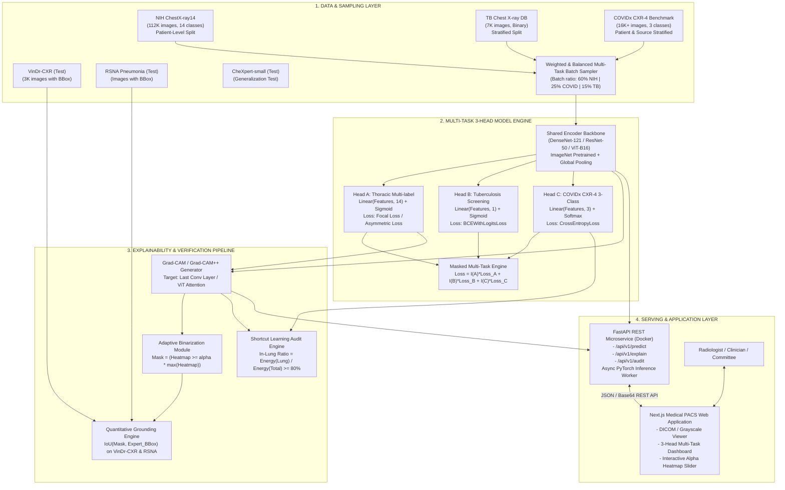

# 🏛️ TECHNICAL ARCHITECTURE DOCUMENT (TECH_ARCHITECTURE.md)
## Nền tảng LungRay: Hệ Thống Học Sâu Đa Nhiệm & Giải Thích Định Vị Tổn Thương X-Quang Ngực (LungRay Multi-Task 3-Head + WSOL + Full-stack Decoupled)

---

| Thuộc tính | Chi tiết |
|:---|:---|
| **Nền tảng** | **LungRay** (CXR Multi-Task CADx + WSOL Grounding Engine) |
| **Kiến trúc** | Decoupled Microservices: PyTorch Core + FastAPI + Next.js PACS |
| **Thiết kế bởi** | Senior AI Engineer / Staff AI Architect (10+ YOE) |
| **Trạng thái** | ✅ BASELINE SPECIFIED & APPROVED |

---

## 1. NGUYÊN TẮC THIẾT KẾ HỆ THỐNG (SYSTEM PRINCIPLES)

1. **Shared Feature Representation with Isolated Task Heads (Kiến trúc biểu diễn chung, cách ly nhánh nhiệm vụ)**:
   Một backbone học sâu duy nhất (shared encoder) trích xuất đặc trưng hình thái lồng ngực tổng quát; 3 classification heads độc lập cho từng không gian nhãn riêng biệt, ngăn chặn hoàn toàn hiện tượng xung đột taxonomy (label clash).
2. **Masked Multi-Task Loss & Balanced Batch Sampling**:
   Mỗi mini-batch chỉ cập nhật gradient cho head tương ứng với nguồn gốc dữ liệu của batch đó. Tỷ lệ lấy mẫu giữa các nguồn (NIH: 112K, COVIDx CXR-4: 16K+, TB: 7K) được kiểm soát thông qua Weighted Batch Sampler để ngăn ngừa Task Starvation.
3. **Rigorous Data Integrity (Liêm chính dữ liệu tuyệt đối)**:
   - Chống **Data Leakage**: Phân chia theo `Patient_ID` (toàn bộ ảnh của cùng một bệnh nhân chỉ nằm trong đúng một tập Train, Val, hoặc Test).
   - Chống **Shortcut Learning**: Phân tầng theo nguồn ảnh gốc (`data_source`) cho bộ dữ liệu COVIDx CXR-4 Benchmark (`andyczhao/covidx-cxr2`).
4. **Verifiable & Quantifiable Explainability (XAI có thể định lượng)**:
   Không dừng lại ở việc xem bản đồ nhiệt bằng mắt thường. Hệ thống chuyển đổi heatmap liên tục thành mặt nạ nhị phân thông qua ngưỡng thích nghi và đo đạc định lượng chỉ số IoU so với Bounding Box chuyên gia trên VinDr-CXR và RSNA.
5. **Decoupled Production Architecture**:
   Phân tách hoàn toàn giữa lõi tính toán AI (Python/PyTorch/FastAPI containerized) và giao diện trải nghiệm người dùng (Next.js/React mô phỏng trạm đọc phim y tế PACS).

---

## 2. SƠ ĐỒ KIẾN TRÚC TỔNG THỂ (SYSTEM ARCHITECTURE DIAGRAM)



---

## 3. THIẾT KẾ KỸ THUẬT CHI TIẾT (SUBSYSTEM SPECIFICATIONS)

### 3.1. Phân bổ Dữ liệu & Chiến lược Lấy Mẫu (Data Strategy & Batch Sampling)

#### Quy định phân chia tập dữ liệu (Splits Design)
- **NIH ChestX-ray14**:
  - Thuật toán: Nhóm theo `Patient_ID` $\to$ phân bổ 70% Train / 10% Validation / 20% Test.
  - Ràng buộc: $Train_{patient} \cap Val_{patient} = \emptyset$ và $Train_{patient} \cap Test_{patient} = \emptyset$.
- **COVIDx CXR-4 Benchmark (`andyczhao/covidx-cxr2`)**:
  - Cấu trúc nguồn gốc: 3 lớp chuẩn hóa (COVID-19: 0, Normal: 1, Pneumonia: 2) theo công bố quốc tế COVID-Net (*Nature Scientific Reports*).
  - Phân chia: Đảm bảo Zero Patient Data Leakage thông qua `patient_id` và Source-Stratified theo `data_source` (BIMCV, Stony Brook, RSNA, v.v.), tránh rò rỉ đặc thù của một máy chụp đơn lẻ.
- **Tuberculosis (TB) Chest X-ray Database**:
  - Phân chia Stratified ngẫu nhiên 70/10/20 do tập dữ liệu không công khai cột Patient ID.

#### Thuật toán Weighted/Balanced Multi-Task Sampler
Do kích thước 3 tập dữ liệu chênh lệch lớn:
- NIH: $N_A = 112.120$ ảnh
- COVIDx CXR-4: $N_C \approx 16.000+$ ảnh
- TB: $N_B = 7.000$ ảnh

Nếu lấy mẫu ngẫu nhiên đồng đều theo ảnh, tỷ lệ batch sẽ là $16 : 3 : 1$, khiến Head B và Head C bị "đói" dữ liệu và mô hình tối ưu thiên vị cho Head A.
Hệ thống sử dụng `WeightedMultiTaskBatchSampler`:
$$\text{Batch Composition}: 60\% \text{ Samples từ NIH} \quad|\quad 25\% \text{ Samples từ COVID} \quad|\quad 15\% \text{ Samples từ TB}$$
Mỗi epoch được xác định theo chu kỳ của tập dữ liệu lớn nhất (NIH), các tập nhỏ hơn sẽ được lặp lại (oversampled) có tăng cường dữ liệu ngẫu nhiên (data augmentation) để tạo mẫu mới.

---

### 3.2. Mô hình Học Sâu & Kiến Trúc Masked Multi-Task (Model Architecture)

#### 1. Chuẩn hóa Độ Phân Giải Đầu Vào & Không Gian Đặc Trưng ($512 \times 512$)
- **Kích thước ảnh chuẩn**: $X \in \mathbb{R}^{3 \times 512 \times 512}$ cho toàn bộ 3 heads (NIH, TB, COVID) và các tập test/eval (VinDr-CXR, RSNA, CheXpert).
- **Cơ sở khoa học**:
  - *Chống suy giảm tổn thương vi mô*: Theo Sabottke & Spieler (2020, *Radiology: AI*), các tổn thương dạng nốt (*Nodule*) và giãn phế nang (*Emphysema*) trên NIH ChestX-ray14 suy giảm rõ rệt ở $224\text{px}$.
  - *Triệt tiêu Shortcut Learning nội tại*: Wollek et al. (2023) chứng minh độ phân giải thấp khiến mô hình bám vào đặc trưng giả (*spurious features*); chuẩn $512\text{px}$ cải thiện AUC thêm 1.5–2.0%.
  - *Độ phân giải cho WSOL*: Downsample 32 lần cho feature map cuối $16 \times 16$ (so với $7 \times 7$ ở $224\text{px}$), cải thiện độ mịn không gian gấp $\approx 5.2$ lần, giúp Grad-CAM đạt tiêu chí Mean IoU $\ge 0.35$.

#### 2. Shared Encoder (Trích xuất đặc trưng chung)
- **Primary Backbone**: **DenseNet-121**
  - Tầng trích xuất: `features.denseblock4` sinh feature map kích thước $1024 \times 16 \times 16$.
  - Ưu thế: Kết nối dày đặc (Dense connectivity) bảo tồn vân tổn thương và đường bờ màng phổi ở độ phân giải $16 \times 16$.
- **Alternative Backbones**:
  - **ResNet-50**: Sinh feature map $2048 \times 16 \times 16$.
  - **Vision Transformer (ViT-B/16 / Swin-T)**:
    - Kích thước pretrained gốc: $224 \times 224$ (grid $14 \times 14 = 196$ patches) hoặc $384 \times 384$ (grid $24 \times 24 = 576$ patches).
    - **Cơ chế Resample Positional Embedding**: Khi nhận ảnh $512 \times 512$ (patch $16 \times 16 \implies 32 \times 32 = 1024$ patches), hệ thống sử dụng thuật toán nội suy bicubic 2D qua hàm `timm.layers.resample_abs_pos_embed` để thích ứng linh hoạt positional embedding mà không làm mất trọng số pretrained.

#### 3. Classifier Heads
- **Feature Vector $z \in \mathbb{R}^D$** ($D = 1024$ với DenseNet-121, $D = 2048$ với ResNet-50, $D = 768$ với ViT-Base) sau Global Average Pooling (GAP) và Dropout ($p = 0.2$):
  - **Head A (Thoracic Multi-label, $C = 14$)**:
    $$f_A(z) = W_A z + b_A \in \mathbb{R}^{14} \implies \hat{p}_{A, c} = \sigma((f_A(z))_c)$$
  - **Head B (Tuberculosis Binary, $C = 1$)**:
    $$f_B(z) = W_B z + b_B \in \mathbb{R}^{1} \implies \hat{p}_B = \sigma(f_B(z))$$
  - **Head C (COVIDx CXR-4 3-Class, $C = 3$)**:
    $$f_C(z) = W_C z + b_C \in \mathbb{R}^{3} \implies \hat{P}_C = \text{Softmax}(f_C(z)) \in [0, 1]^3$$

#### 3. Masked Multi-Task Loss Engine
Với mỗi mẫu thứ $i$ trong mini-batch, ký hiệu $k_i \in \{A, B, C\}$ là nhãn nguồn:
$$\mathcal{L}_{\text{total}} = \frac{1}{|B|} \sum_{i \in B} \left[ \mathbb{I}(k_i = A) \cdot \mathcal{L}_{\text{Focal}}(y_{A, i}, \hat{p}_{A, i}) + \mathbb{I}(k_i = B) \cdot \mathcal{L}_{\text{BCE}}(y_{B, i}, \hat{p}_{B, i}) + \mathbb{I}(k_i = C) \cdot \mathcal{L}_{\text{CE}}(y_{C, i}, \hat{P}_{C, i}) \right]$$

Trong đó:
- **Focal Loss** cho Head A để giải quyết mất cân bằng lớp cực hạn (ví dụ Hernia chỉ 0.2%):
  $$\mathcal{L}_{\text{Focal}}(p_t) = -\alpha_t (1 - p_t)^\gamma \log(p_t), \quad \gamma = 2.0, \alpha = 0.25$$

---

### 3.3. Định Vị Giải Thích (WSOL) & Kiểm Toán Shortcut Learning

#### 1. Thuật toán Grad-CAM cho mạng Tích chập
Với lớp bệnh $c$, tính đạo hàm của điểm số dự đoán $y_c$ đối với feature map $A^k$ tại tầng tích chập cuối cùng:
$$\alpha_k^c = \frac{1}{Z} \sum_{i=1}^H \sum_{j=1}^W \frac{\partial y_c}{\partial A_{i, j}^k}$$
Bản đồ kích hoạt trực quan được tổng hợp qua hàm kích hoạt ReLU:
$$M_c = \text{ReLU}\left( \sum_k \alpha_k^c A^k \right)$$
Bản đồ $M_c$ được nội suy song tuyến (bilinear interpolation) về kích thước ảnh gốc $H \times W$ và chuẩn hóa về $[0, 1]$.

#### 2. Adaptive Binarization & Đo lường IoU
Tạo mặt nạ dự đoán nhị phân $\hat{B}_c$:
$$\hat{B}_c(x, y) = \begin{cases} 1 & \text{nếu } M_c(x, y) \ge \tau_{mask} = \alpha \cdot \max(M_c) \\ 0 & \text{ngược lại} \end{cases} \quad (\alpha \in [0.2, 0.4])$$
So sánh với Bounding Box chuyên gia $B^{GT}$ trên VinDr-CXR và RSNA:
$$\text{IoU}(\hat{B}_c, B^{GT}) = \frac{|\hat{B}_c \cap B^{GT}|}{|\hat{B}_c \cup B^{GT}|}$$

#### 3. Quy trình Kiểm toán Shortcut Learning Audit (Head C)
Để loại trừ khả năng mô hình học thuộc dấu ấn của máy chụp/watermark nguồn ảnh:
1. Tạo mặt nạ vùng phổi tiêu chuẩn $P_{\text{lung}}$ (bằng thuật toán phân đoạn hình thái ngưỡng Otsu kết hợp giải phẫu lồng ngực).
2. Tính tỷ lệ năng lượng nhiệt Grad-CAM tập trung trong phổi:
   $$\text{In-Lung Activation Ratio} = \frac{\sum_{(x,y) \in P_{\text{lung}}} M_{\text{COVID}}(x,y)}{\sum_{(x,y)} M_{\text{COVID}}(x,y)}$$
3. **Tiêu chuẩn kiểm toán**: Nếu tỷ lệ này $\ge 80\%$, ca bệnh được xác nhận vượt qua kiểm toán (Pass Audit). Nếu $< 75\%$, hệ thống ghi nhận vi phạm Shortcut Learning.

---

## 4. THIẾT KẾ GIAO TIẾP HỆ THỐNG & API SPECIFICATIONS

Backend FastAPI cung cấp các chuẩn RESTful endpoints sau:

### 4.1. `POST /api/v1/predict`
Suy luận đa nhiệm 3-Head từ ảnh tải lên.
- **Request**: `multipart/form-data` chứa file ảnh (`image`: file DICOM/PNG/JPG).
- **Response**:
```json
{
  "status": "success",
  "inference_time_ms": 142.5,
  "head_a_nih": {
    "predictions": [
      {"pathology": "Atelectasis", "probability": 0.12, "threshold": 0.35, "positive": false},
      {"pathology": "Cardiomegaly", "probability": 0.88, "threshold": 0.42, "positive": true},
      {"pathology": "Effusion", "probability": 0.74, "threshold": 0.38, "positive": true}
      // ... 14 bệnh
    ]
  },
  "head_b_tb": {
    "probability": 0.04,
    "threshold": 0.50,
    "diagnosis": "Normal",
    "positive": false
  },
  "head_c_covid": {
    "probabilities": {
      "COVID-19": 0.02,
      "Normal": 0.15,
      "Pneumonia": 0.83
    },
    "diagnosis": "Pneumonia"
  }
}
```

### 4.2. `POST /api/v1/explain`
Sinh heatmap Grad-CAM và trả về ảnh trực quan hóa.
- **Request**:
  - `image`: file ảnh
  - `task`: `"head_a"` | `"head_b"` | `"head_c"`
  - `target_class`: Ví dụ `"Cardiomegaly"` hoặc `"COVID-19"`
  - `alpha_mask`: Ngưỡng binarize (mặc định: `0.3`)
- **Response**:
```json
{
  "status": "success",
  "target_class": "Cardiomegaly",
  "heatmap_base64": "data:image/png;base64,iVBORw0KGgo...",
  "overlay_base64": "data:image/png;base64,iVBORw0KGgo...",
  "bounding_box_proposal": [120, 180, 420, 450]
}
```

### 4.3. `POST /api/v1/audit`
Thực hiện kiểm toán Shortcut Learning cho ảnh dương tính COVID.
- **Request**: File ảnh
- **Response**:
```json
{
  "in_lung_ratio": 0.865,
  "passed_audit": true,
  "verdict": "Vùng kích hoạt tập trung 86.5% trong phế trường phổi. Không phát hiện rủi ro Shortcut Learning.",
  "lung_mask_base64": "data:image/png;base64,..."
}
```

---

## 5. HẠ TẦNG HUẤN LUYỆN & QUẢN LÝ THÍ NGHIỆM (MLOPS PIPELINE)

### 5.1. Môi trường Tính toán Kaggle Cloud
- **GPU Quota**: Kaggle NVIDIA Tesla P100 (16GB VRAM) hoặc 2x NVIDIA T4.
- **Mount Dataset trực tiếp**: Tận dụng các Kaggle Datasets có sẵn không cần tải về máy local:
  - NIH ChestX-ray14: `/kaggle/input/data/`
  - Tuberculosis Chest X-ray Database: `/kaggle/input/tuberculosis-tb-chest-xray-dataset/`
  - COVIDx CXR-4: `/kaggle/input/covidx-cxr2/` (hoặc `/kaggle/input/covid19-radiography-database/`)
  - VinDr-CXR: `/kaggle/input/vindr-cxr/`
- **Tối ưu tốc độ huấn luyện**:
  - Mixed Precision Training: `torch.cuda.amp.autocast()` tiết kiệm 45% VRAM và tăng tốc 1.8x.
  - Pre-resized cache: chuẩn hóa $512 \times 512$.
  - Multi-worker DataLoader: `num_workers=4`, `pin_memory=True`.

### 5.2. Quản lý Thí nghiệm (Experiment Tracking)
- Quản lý cấu hình qua file YAML chuẩn hóa (`configs/model_config.yaml`).
- Tích hợp **Weights & Biases (WandB)** hoặc **TensorBoard**:
  - Logging liên tục: Loss theo từng head, Learning rate, GPU Memory.
  - Validation metrics: AUC-ROC riêng biệt cho 14 bệnh NIH, AUC Lao phổi, Macro F1 COVID-19.
  - Checkpointing: Tự động lưu mô hình có validation loss tổng hợp thấp nhất (`best_model.pth`).

---

## 6. KIẾN TRÚC TRIỂN KHAI PHẦN MỀM (DEPLOYMENT & DOCKER ARCHITECTURE)

Hệ thống được đóng gói thông qua Docker Compose gồm 2 containers:

```
┌────────────────────────────────────────────────────────┐
│                   DOCKER HOST                          │
│                                                        │
│  ┌───────────────────────┐   ┌──────────────────────┐  │
│  │  nextjs-pacs-viewer   │   │  fastapi-ai-backend  │  │
│  │  Port 3000            │   │  Port 8000           │  │
│  │                       │   │                      │  │
│  │  - Next.js 14 App     │   │  - PyTorch Runtime   │  │
│  │  - Cornerstone.js     │◄──┤  - Pretrained Weights│  │
│  │  - Medical Theme UI   │   │  - Grad-CAM Engine   │  │
│  └───────────▲───────────┘   └──────────▲───────────┘  │
│              │                          │              │
└──────────────┼──────────────────────────┼──────────────┘
               │                          │
        HTTP Client (Web)            REST API
```

- **Container 1 (`fastapi-ai-backend`)**:
  - Base Image: `python:3.10-slim`
  - Dependencies: PyTorch CPU/CUDA, torchvision, OpenCV-headless, FastAPI, Uvicorn, pydantic.
  - Volume mount: Thư mục `checkpoints/` lưu `best_model.pth`.
- **Container 2 (`nextjs-pacs-viewer`)**:
  - Base Image: `node:18-alpine`
  - Tính năng: Giao diện trạm chẩn đoán DICOM (Cornerstone.js / Canvas), bảng phân tích 3 head, điều khiển độ mờ heatmap trực tiếp.
