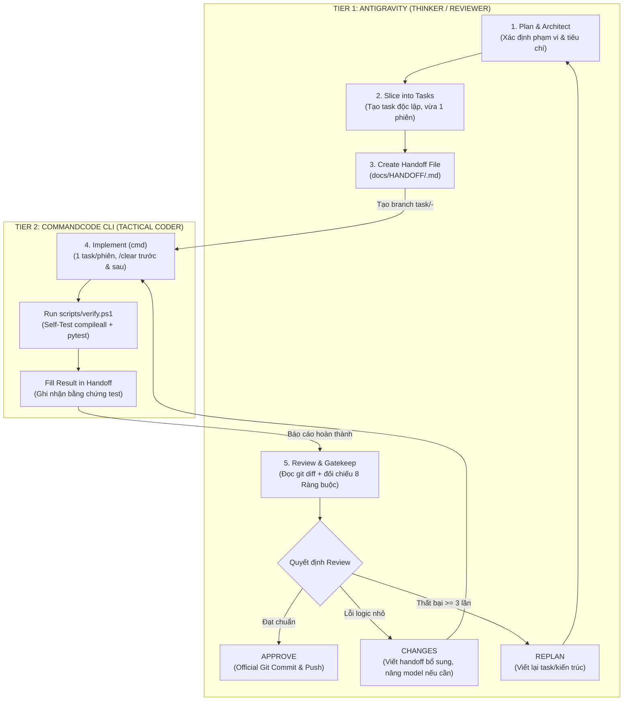

# 🔄 QUY TRÌNH HỢP TÁC 2 TẦNG: ANTIGRAVITY & COMMANDCODE GO
## Vòng Lặp Vận Hành (Operating Loop) & Phân Định Trách Nhiệm (Two-Tier Model)

---

## 1. NGUYÊN TẮC PHÂN VAI CỨNG (STRICT SEPARATION OF CONCERNS)

| Tiêu chí | Tier 1: Antigravity (IDE Agent - Google AI Pro) | Tier 2: CommandCode CLI (Terminal - Gói Go $1) |
|:---|:---|:---|
| **Vai trò** | **Chief AI Architect & Quality Gatekeeper** | **Tactical Coding & Execution Engine** |
| **Trách nhiệm** | Lên kế hoạch, thiết kế kiến trúc, chia nhỏ task, viết handoff, review `git diff`, phụ trách `git commit` / `git push`. | Viết code logic, sửa bug, chạy kiểm thử, điền kết quả vào file handoff. |
| **Giới hạn** | **KHÔNG** viết code logic hàng loạt; giao việc rõ ràng, tiết kiệm quota 5h. | **KHÔNG** tự ý đổi kiến trúc, taxonomy, dataset hoặc sửa file ngoài phạm vi. |
| **Kênh giao tiếp** | File trong repo (`docs/HANDOFF/*.md`) + Git branches. **KHÔNG** có API nối tắt. |

---

## 2. SƠ ĐỒ VÒNG LẶP VẬN HÀNH (THE 6-STEP CYCLE)

---

## 3. QUY TRÌNH THỰC THI CHI TIẾT (LÀM VIỆC TRỰC TIẾP TRÊN NHÁNH MAIN)

1. **Step 1 - Plan (Antigravity)**: Đọc yêu cầu, đối chiếu [docs/PLAN.md](file:///c:/Users/TanPhat/Documents/AI_E/Chest%20X-rays/docs/PLAN.md) và 8 Ràng Buộc Sống Còn.
2. **Step 2 - Slice (Antigravity)**: Chia nhỏ thành các task độc lập trong [docs/TASKS.md](file:///c:/Users/TanPhat/Documents/AI_E/Chest%20X-rays/docs/TASKS.md).
3. **Step 3 - Handoff (Antigravity)**: Tạo file `docs/HANDOFF/<ID>-<slug>.md` chỉ rõ file được sửa, interface và tiêu chí nghiệm thu.
4. **Step 4 - Implement (CommandCode)**:
   - **Làm việc trực tiếp trên nhánh `main`**: Không cần chuyển nhánh rườm rà.
   - Mở CommandCode CLI (`cmd`), kiểm tra `/usage`.
   - **Khi nào giữ session vs khi nào `/clear`?**:
     - *Giữ session*: Khi task mới kế thừa trực tiếp kết quả của task vừa làm (ví dụ: Frontend gọi các routes Backend vừa tạo), giữ session giúp model nhớ ngữ cảnh liên tục.
     - *Nên `/clear`*: Khi session quá dài (gõ prompt thấy trả lời chậm hoặc trừ credit nhiều), hoặc khi chuyển sang một mảng hoàn toàn khác (ví dụ: xong data pipeline chuyển sang viết báo cáo luận án).
5. **Step 5 - Verify & Gatekeep (Cơ chế Chống Xung Đột)**:
   - Chạy script kiểm tra toàn diện: `powershell -File scripts/verify.ps1`.
   - Khi verify pass 100%, CommandCode điền `## Result` trong file handoff.
   - Antigravity kiểm duyệt `git status` và `git diff` để đảm bảo code sạch, không chạm file cấm, rồi commit trực tiếp trên `main`.

---

## 4. ĐIỀU KIỆN DỪNG & CHỐNG ĐỐT QUOTA (CIRCUIT BREAKER)

- **Quy tắc 2 lần**: Nếu model tầng thấp (S0 hoặc T1) làm sai 2 lần liên tiếp trên cùng một lỗi $\to$ **Nâng ngay 1 bậc model** (lên T2: Kimi K2.7 Code hoặc GLM-5.3).
- **Quy tắc 3 lần (Hard Stop)**: Tổng số lần thất bại của 1 task chạm ngưỡng **3 lần** $\to$ **DỪNG NGAY LẬP TỨC**. Antigravity bắt buộc phải xem xét lại thiết kế, chia nhỏ task thêm hoặc viết lại tài liệu đặc tả, không để CommandCode tiếp tục thử sai làm cạn quota Go.
- **Git Worktree**: Khi cần thực hiện các task song song độc lập, sử dụng tính năng Git Worktree để cô lập working tree sạch sẽ:
  `git worktree add ../LungRay-task-<ID> task/<ID>-<slug>` (`VERIFY: kiểm tra cú pháp tại docs Git Worktrees`).
